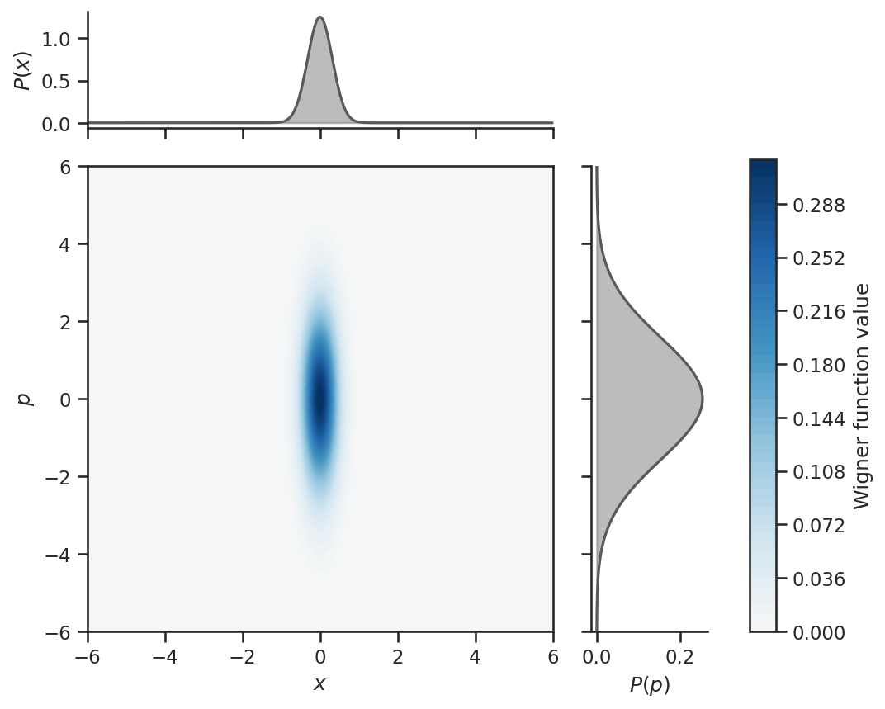
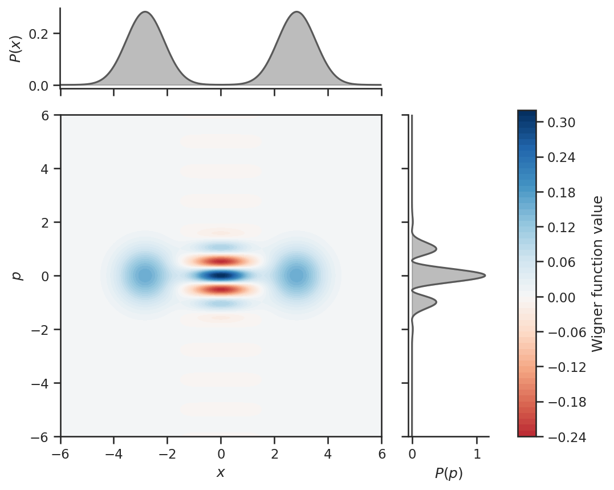
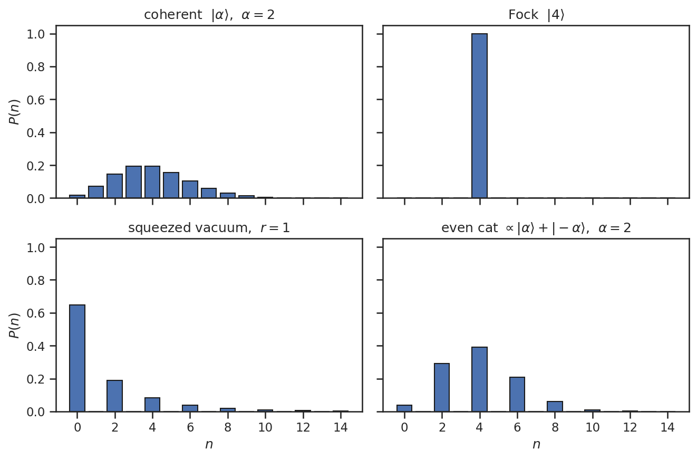
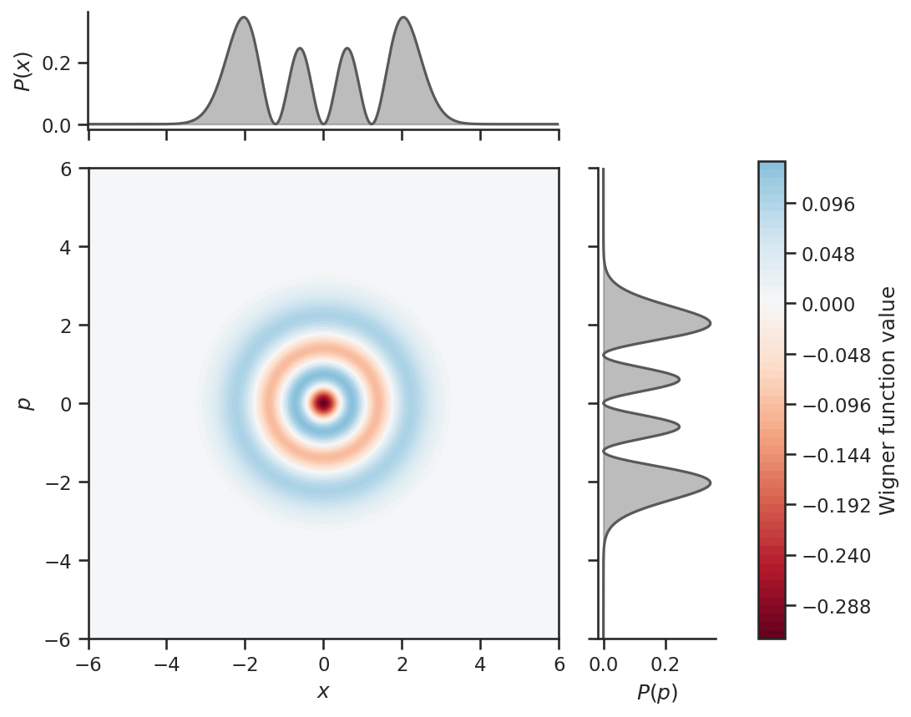
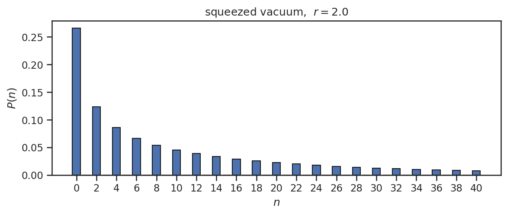

(sec:measurement)=

# Introduction to Measurement

In quantum computing, *measurement* is the process by which classical information is extracted from a quantum state. In conventional discrete-variable quantum computing, measurement of a qubit yields one of a finite set of outcomes (e.g. $0$ or $1$) corresponding to a projection onto the computational basis. Continuous-variable (CV) quantum computing is qualitatively different: a single bosonic mode admits two physically distinct measurement schemes, each projecting onto a different eigenbasis and yielding fundamentally different types of outcomes.

In quantum mechanics, every measurable physical quantity (observable) is represented by a Hermitian operator acting on the state space. Measurement projects the state onto an eigenstate of that operator and yields the corresponding eigenvalue as the outcome. A bosonic mode can be described in either a continuous *quadrature basis* (eigenstates of $\hat{x}$ or $\hat{p}$) or a discrete *Fock basis* (eigenstates of the number operator $\hat{n}$). Correspondingly, the two main measurement schemes in CV quantum computing are

- *Homodyne measurement* — projects onto a quadrature eigenstate and returns a continuous real outcome.
- *Fock-number measurement* — projects onto a Fock state and returns a non-negative integer.

|                       | Discrete Qubit                     | Homodyne (CV)               | Fock Number (CV)                   |
| --------------------- | ---------------------------------- | --------------------------- | ---------------------------------- |
| Outcome space         | $\{0, 1\}$                         | $\mathbb{R}$                | $\mathbb{N}$                       |
| Observable            | Pauli $\hat{Z}$, $\hat{X}, \ldots$ | $\hat{x}_\phi$              | $\hat{n} = \hat{a}^\dagger\hat{a}$ |
| Projected eigenstates | $\ket{0}, \ket{1}$                 | $\ket{x_\phi}$ (continuous) | $\ket{n}$ (Fock states)            |

These two measurements are *complementary*: a state whose outcome distribution is narrowly concentrated (sharp) under one measurement necessarily has a widely spread (broad) distribution under the other, reflecting the general principle that non-commuting observables cannot be simultaneously sharp. Information about a quantum state is therefore unavoidably partial, and the choice of measurement determines which slice of it can be extracted. In what follows, we introduce both measurements in turn, covering what observable each one projects onto and what the outcome statistics look like for representative states, and then return to their complementarity with concrete examples.

---

(sec:measurement-homodyne)=

## 1. Homodyne Measurement

### 1.1 What It Measures

Homodyne measurement is a projective measurement onto eigenstates of a quadrature operator. With the measurement phase set to $\phi$, the measured observable is

$$
\hat{x}_\phi = \hat{x}\cos\phi + \hat{p}\sin\phi.
$$

The two special choices recover the $\hat{x}$ and $\hat{p}$ quadratures:

- $\phi = 0$ measures $\hat{x}$,
- $\phi = \pi/2$ measures $\hat{p}$.

The outcome is a real number $x_\phi \in \mathbb{R}$, the eigenvalue of $\hat{x}_\phi$ corresponding to the projected eigenstate $\ket{x_\phi}$. Unlike a qubit measurement, there is no discrete set of outcomes: every real number is, in principle, a possible result.

### 1.2 Probability Distribution of the Outcome

For a pure state $\ket{\psi}$, the probability density of obtaining outcome $x_\phi$ follows from the Born rule:

$$
p(x_\phi) = |\braket{x_\phi | \psi}|^2.
$$

The following examples illustrate how the outcome distribution depends on the state.

- *Coherent state* $\ket{\alpha}$. The distribution is a Gaussian whose mean equals $\langle \hat{x}_\phi \rangle$ and whose variance equals the vacuum fluctuation $\hbar/2$. The shape of the distribution does not depend on $\phi$ — only its center moves.
- *Squeezed state*. The variance is anisotropic. Along the squeezed quadrature the distribution is narrower than the vacuum (variance $e^{-2r}\,\hbar/2$, where $r$ is the squeezing parameter); along the anti-squeezed quadrature it is broader (variance $e^{2r}\,\hbar/2$). Measuring the squeezed quadrature yields a sharp outcome; measuring the anti-squeezed quadrature yields a broad one.

The figure below shows the Wigner function $W(x, p)$ of a squeezed vacuum together with its marginals $P(x) = \int W(x, p)\,dp$ (top) and $P(p) = \int W(x, p)\,dx$ (right) — these are the homodyne outcome distributions at $\phi = 0$ and $\phi = \pi/2$.

For non-Gaussian states the marginals are non-Gaussian as well. The even cat state $\propto \ket{\alpha} + \ket{-\alpha}$ has a Wigner function with negative interference fringes between two displaced humps, so its $P(x)$ is bimodal and $P(p)$ oscillates. The marginals themselves are always non-negative — they are probability densities — even when the underlying $W(x, p)$ is not.

### 1.3 Connection to the Uncertainty Relation

The variances of conjugate quadratures obey the Heisenberg uncertainty relation

$$
\Delta x \cdot \Delta p \geq \frac{\hbar}{2},
$$

with equality for *minimum uncertainty states* such as coherent states and pure squeezed states. Because the variance of the homodyne outcome is precisely the quadrature fluctuation of the state, this inequality is observed directly in the outcome distributions: any state that is sharp in $\hat{x}$ must be broad in $\hat{p}$, and vice versa. Squeezing exploits this trade-off — improving precision along one quadrature at the unavoidable cost of degrading it along the other.

---

(sec:measurement-fock)=

## 2. Fock-Number Measurement

### 2.1 What It Measures

Fock-number measurement is a projective measurement onto eigenstates of the number operator $\hat{n} = \hat{a}^\dagger \hat{a}$:

$$
\hat{n}\ket{n} = n\ket{n}, \qquad n = 0, 1, 2, \ldots
$$

The outcome is a non-negative integer $n \in \mathbb{N}$ — the number of photons detected in the mode. In contrast to homodyne measurement, Fock-number measurement discards all *phase* information: projection onto a Fock state erases phase entirely, since Fock states have a uniform phase distribution.

### 2.2 Probability Distribution of the Outcome

For a state $\ket{\psi}$, the probability of detecting exactly $n$ photons is

$$
P(n) = |\braket{n | \psi}|^2.
$$

The following examples illustrate how $P(n)$ varies widely with the state.

- *Coherent state* $\ket{\alpha}$. $P(n)$ is a Poisson distribution with mean $|\alpha|^2$ and width $\sqrt{|\alpha|^2}$.
- *Fock state* $\ket{n_0}$. The outcome is deterministically $n = n_0$: the distribution is a single bar at $n_0$ with probability $1$.

Two further examples illustrate states with support only on even Fock numbers, but for different reasons and with very different envelopes.

- *Squeezed vacuum*. The squeezing operator $\hat{S}(r) = \exp\!\bigl[\tfrac{r}{2}(\hat{a}^2 - \hat{a}^{\dagger 2})\bigr]$ contains only $\hat{a}^{\dagger 2}$ (creates two photons) and $\hat{a}^2$ (annihilates two photons), so the Fock number changes exclusively in steps of two. Applied to the vacuum $\ket{0}$, only even $n$ are populated. $P(n)$ peaks at $n = 0$ and decays through even values.
- *Even cat state* $\propto \ket{\alpha} + \ket{-\alpha}$. An eigenstate of the photon-parity operator with eigenvalue $+1$. The envelope is concentrated near $|\alpha|^2$ rather than at $n = 0$.

---

## 3. Complementarity Between the Two Measurements

The two measurements probe complementary aspects of the same mode. This is rooted in the fact that $\hat{x}_\phi$ and $\hat{n}$ do not commute, meaning they cannot be simultaneously diagonalized: a state that is sharp under one is correspondingly broad under the other. The Fock and squeezed-vacuum states are clear examples.

- A *Fock state* has a Fock-number distribution concentrated on a single value of $n$, but has a broad, non-Gaussian quadrature distribution, as illustrated below.

  

- A *squeezed vacuum state*, which approximates a quadrature eigenstate, has a narrowly peaked quadrature distribution but spreads over many Fock numbers, as shown below.

  

The choice between homodyne and Fock-number measurement is therefore not interchangeable: each one extracts information that the other cannot. Designing a CV quantum-computing protocol is in part a matter of choosing the right measurement for the observable of interest.

---

## 4. The Two Measurements in the SDK

Both schemes are operations you apply to a mode, and either one **consumes** the mode it reads: the mode is discarded afterwards and cannot be operated on again.

| | Operation | Outcome | Where it runs |
| --- | --- | --- | --- |
| Homodyne | {py:class}`std.MeasureHomodyne <claveles.circuit.ops.std.MeasureHomodyne>`, taking the phase $\phi$ | `float` | Everywhere: the machine measures nothing else, and both simulator backends support it |
| Fock number | {py:class}`std.MeasureFock <claveles.circuit.ops.std.MeasureFock>` | `int` | The simulator's Fock backend only; the machine has no photon detector |

{py:class}`~claveles.circuit.ops.std.MeasureFock` also takes `post_select=n`, which fixes the outcome to $n$ photons instead of sampling one from $P(n)$ — useful for preparing the state conditioned on a particular detection.

A measurement hands back the value it read as a variable, which an operation later in the circuit can use as a parameter. That is the mechanism the machine computes with, and it is described in [Feedforward](feedforward.ipynb).

The quadrature distributions above are the marginals of a state's Wigner function, and {py:meth}`QuantumState.draw_wigner <claveles.circuit.state.QuantumState.draw_wigner>` is what plots that Wigner function. The Fock-number distribution is a different object — not a marginal of it — and the SDK draws no figure for it: {py:meth}`QuantumState.ket <claveles.circuit.state.QuantumState.ket>` and {py:meth}`QuantumState.dm <claveles.circuit.state.QuantumState.dm>` hand back the amplitudes as arrays, from which $P(n)$ is `abs(ket())**2`, or equivalently `dm().diagonal().real`. See {ref}`Working with Quantum States <sec:quantum-states-in-the-sdk>`.

---

## Summary

In this tutorial, we have learned the following:

1. *Projective measurement in CV systems*: A bosonic mode admits two complementary measurement schemes — homodyne and Fock-number — each projecting onto a different eigenbasis of the same Hilbert space.
2. *Homodyne measurement*: Projects onto eigenstates of $\hat{x}_\phi = \hat{x}\cos\phi + \hat{p}\sin\phi$ and returns a continuous real outcome. Outcome statistics directly reflect quadrature fluctuations and obey the Heisenberg uncertainty relation $\Delta x \cdot \Delta p \geq \hbar/2$.
3. *Fock-number measurement*: Projects onto Fock states $\ket{n}$ and returns a non-negative integer $n \in \mathbb{N}$. The outcome distribution is Poisson for a coherent state and a delta function for a Fock state, and phase information is discarded.
4. *Complementarity*: A state that is sharp in one measurement is broad in the other. The choice of measurement determines what information about the state is accessible.
5. *In the SDK*: {py:class}`std.MeasureHomodyne <claveles.circuit.ops.std.MeasureHomodyne>` and {py:class}`std.MeasureFock <claveles.circuit.ops.std.MeasureFock>`, either of which consumes the mode it reads.

Where to go next:

* {ref}`Introduction to Gate Operations <sec:ops>` — the transformations applied between preparation and measurement.
* {ref}`Introduction to Quantum States <sec:states>` — the states whose distributions are plotted above, if you have not read it yet.
* [Simulating Circuit](simulation.ipynb) — measuring a circuit for real, and reading the state a shot left behind.
