(sec:ops)=

# Introduction to Gate Operations

The previous introductions described quantum states as static objects. Computation, however, comes from *transforming* states. In CV quantum computing, this is done by applying *unitary operators*, called *operations* (and also referred to as *gates*), to one or more bosonic modes. An operation $\hat{U}$ evolves a state vector $\ket{\psi}$ as $\ket{\psi} \mapsto \hat{U}\ket{\psi}$, and a quantum algorithm is, in essence, a sequence of such operations followed by measurement.

Because a bosonic mode lives in an infinite-dimensional Hilbert space, its operations form a far richer family than the discrete unitaries of qubit circuits. The most useful way to organize this family is by the order of the *generator*, the Hermitian operator $\hat{G}$ in $\hat{U} = e^{-i\hat{G}}$, expressed as a polynomial in the quadrature operators $\hat{x}, \hat{p}$ (the orthogonal field components introduced in {ref}`Introduction to Quantum States <sec:states>`), or equivalently in the annihilation and creation operators $\hat{a}, \hat{a}^\dagger$ related to them by $\hat{a} = (\hat{x} + i\hat{p})/\sqrt{2\hbar}$, where $\hbar$ is the reduced Planck constant:

- **Gaussian operations** have generators at most *quadratic* in $\hat{x}, \hat{p}$. They map Gaussian states to Gaussian states, acting on phase space as affine transformations (translations, rotations, and squeezes). Displacement, phase rotation, squeezing, and the beam splitter all belong to this class.
- **Non-Gaussian operations** have generators of *higher* order. They can deform a state beyond Gaussian form and, crucially, can drive the Wigner function negative, a hallmark of genuinely non-classical resources. The Kerr gate and the cubic phase gate are the canonical examples.

|                           | Gaussian operations                              | Non-Gaussian operations            |
| ------------------------- | ------------------------------------------------ | ---------------------------------- |
| Generator order           | $\leq 2$ in $\hat{x}, \hat{p}$                   | $> 2$ in $\hat{x}, \hat{p}$        |
| Effect on Wigner function | Affine (preserves Gaussian shape)                | Can introduce negativity           |
| Examples                  | Displacement, rotation, squeezing, beam splitter | Kerr, cubic phase                  |
| Classical simulability    | Efficient                                        | Hard (source of quantum advantage) |

This distinction is not merely descriptive. Gaussian operations applied to Gaussian states can be simulated efficiently on a classical computer, so they alone cannot deliver a quantum advantage. Reaching *universal* CV quantum computation requires supplementing the set of Gaussian operations with at least one non-Gaussian element. Understanding both classes, and how they act on states, is therefore the goal of this introduction.

To make an operation's effect concrete, we visualize how it transforms a state using two complementary views:

- The **Wigner function** $W(x, p)$ gives the most direct picture, since Gaussian operations show up as simple geometric motions in phase space while non-Gaussian operations reveal themselves through emerging negativity. Projecting $W(x, p)$ onto one quadrature axis, that is, integrating out the orthogonal quadrature, gives the *homodyne distribution* of that quadrature, the statistics a homodyne measurement would record; this marginal viewpoint is developed in {ref}`Introduction to Measurement <sec:measurement>`.
- The **Fock-number distribution** exposes structure that phase-space pictures obscure, such as the Poissonian statistics of a coherent state or the even-only support of a squeezed vacuum.

In the following we first formalize how operators represent operations and state the operation definitions used throughout. We then discuss what makes a gate set universal, motivating the need for non-Gaussian operations. With that foundation, we examine three families in turn: single-mode Gaussian operations (displacement, rotation, squeezing), single-mode non-Gaussian operations (the Kerr and cubic phase gates), and two-mode operations such as the beam splitter. Along the way we see the non-classicality the non-Gaussian gates generate and the entanglement the beam splitter brings into the picture.

---

(sec:ops-operators)=

## 1. Representing Operations with Operators

(sec:ops-pictures)=

### 1.1 Two Equivalent Pictures

An operation can be viewed in two equivalent ways. In the *Schrödinger picture*, the operation transforms the state while observables stay fixed. Writing $\hat{\rho}$ for the density operator (the general state description from {ref}`Introduction to Quantum States <sec:states>`, which reduces to $\ket{\psi}\bra{\psi}$ for a pure state),

$$
\ket{\psi} \;\longmapsto\; \hat{U}\ket{\psi}, \qquad \hat{\rho} \;\longmapsto\; \hat{U}\hat{\rho}\hat{U}^\dagger .
$$

In the *Heisenberg picture*, the state stays fixed and any observable $\hat{O}$ (a Hermitian operator representing a measurable quantity, such as $\hat{x}$ or $\hat{p}$) transforms instead:

$$
\hat{O} \;\longmapsto\; \hat{U}^\dagger \hat{O}\, \hat{U} .
$$

Both give identical predictions, since the expectation value $\bra{\psi}\hat{U}^\dagger \hat{O}\, \hat{U}\ket{\psi}$ (where $\bra{\psi}$ is the dual, or bra, vector of $\ket{\psi}$) is the same either way. For CV systems the Heisenberg picture is often the more convenient of the two: Gaussian operations act on the column vector of quadrature operators $(\hat{x}, \hat{p})^T$ by a simple affine rule

$$
\binom{\hat{x}}{\hat{p}} \;\longmapsto\; \mathbf{M} \binom{\hat{x}}{\hat{p}} + \mathbf{d},
$$

where $\mathbf{M}$ is a $2 \times 2$ *symplectic matrix* (the real linear part of the transformation) and $\mathbf{d} \in \mathbb{R}^2$ is a constant *displacement vector*. This is exactly why Gaussian operations map Gaussian states to Gaussian states: they act linearly on the mean vector $\boldsymbol{\mu}$ and covariance matrix $\boldsymbol{\Sigma}$ introduced in {ref}`Introduction to Quantum States <sec:states>`. The matrix form of $\mathbf{M}$ for each gate is tabulated in the {ref}`Gates reference <sec:gates>`; here we focus on the generators and their physical effect.

(sec:ops-gate-definitions)=

### 1.2 Operation Definitions

Every operation is generated by a Hermitian operator through $\hat{U} = e^{-i\hat{G}}$. The operations used throughout this introduction are defined as follows.

- **Displacement** translates the state in phase space. The complex parameter $\alpha$ sets the direction and distance of the shift:

  $$
  \hat{D}(\alpha) = \exp\!\left(\alpha\hat{a}^\dagger - \alpha^*\hat{a}\right), \qquad \alpha \in \mathbb{C},
  $$

  where $\alpha^*$ is the complex conjugate of $\alpha$.

- **Phase rotation** rotates the state about the phase-space origin by the angle $\phi$:

  $$
  \hat{R}(\phi) = \exp\!\left(i\phi\,\hat{a}^\dagger\hat{a}\right), \qquad \phi \in \mathbb{R}.
  $$

- **Squeezing** stretches one quadrature while compressing the conjugate one. The *squeezing parameter* $r \geq 0$ sets the strength, that is, how much the quadratures are stretched and compressed:

  $$
  \hat{S}(r) = \exp\!\left[\frac{r}{2}\left(\hat{a}^2 - \hat{a}^{\dagger 2}\right)\right], \qquad r \geq 0,
  $$

  which compresses $\hat{x}$ and stretches $\hat{p}$, as in {ref}`Introduction to Quantum States <sec:states>`.

- **Beam splitter** mixes two modes while conserving total Fock number. Here $\hat{a}_1, \hat{a}_2$ are the annihilation operators of the two modes being mixed, the *mixing angle* $\theta$ sets the transmission/reflection ratio, and the *relative phase* $\phi$ sets the phase difference between the reflected and transmitted fields:

  $$
  \hat{B}(\theta, \phi) = \exp\!\left[\theta\left(e^{i\phi}\hat{a}_1\hat{a}_2^\dagger - e^{-i\phi}\hat{a}_1^\dagger\hat{a}_2\right)\right], \qquad \theta, \phi \in \mathbb{R}.
  $$

The first three are single-mode generators that are at most quadratic in $\hat{a}, \hat{a}^\dagger$, and the beam splitter is a two-mode quadratic generator. All four are therefore Gaussian. The two non-Gaussian operations introduced later are generated by higher-order terms:

- **Kerr gate**, generated by the quartic term $(\hat{a}^\dagger\hat{a})^2$, with interaction strength $\kappa$:

  $$
  \hat{K}(\kappa) = \exp\!\left[i\kappa\,(\hat{a}^\dagger\hat{a})^2\right], \qquad \kappa \in \mathbb{R}.
  $$

- **Cubic phase gate**, generated by the cubic term $\hat{x}^3$, with cubicity parameter $\gamma$:

  $$
  \widehat{\mathrm{CPG}}(\gamma) = \exp\!\left(i\gamma\,\hat{x}^3\right), \qquad \gamma \in \mathbb{R}.
  $$

```{note}
The definitions above are the ones Claveles implements, so each operation is also the SDK gate of the same name: $\hat{D}$ is {py:class}`std.Displacement <claveles.circuit.ops.std.Displacement>`, $\hat{B}$ is {py:class}`std.BeamSplitter <claveles.circuit.ops.std.BeamSplitter>`, and so on. A `std` operation carries no subscript, which is the convention {ref}`the Gates page <sec:gates-symbols>` states in full. The {ref}`Gates & Operations <sec:gates>` reference gives each of them again with its full symplectic matrix.

Sign and parameter conventions vary across the literature, so a formula taken from elsewhere may not agree with these. Some authors place a minus sign in the Kerr generator, which flips the sign of $\kappa$; others write the squeezing generator as $\hat{a}^{\dagger 2} - \hat{a}^2$, which exchanges the squeezed and anti-squeezed quadratures.

This page keeps $\hbar$ explicit. The SDK works in units with $\hbar = 1$, which is the convention the {ref}`Gates reference <sec:gates>` uses; substitute it to get the numbers the SDK reports.
```

---

(sec:ops-universal)=

## 2. What Makes a Gate Set Universal

A practical quantum computer cannot offer a separate piece of hardware for every conceivable gate. Instead, it provides a small *gate set* and builds any desired operation by composing gates from that set in sequence. A gate set is called *universal* if such compositions can approximate any unitary to arbitrary accuracy. The question is then: which gates must a CV gate set contain to be universal?

### 2.1 Gaussian Operations and Their Limits

The Gaussian operations of {ref}`§1.2 <sec:ops-gate-definitions>` are a natural starting point, since they are the operations most readily realized in the laboratory. By composing displacements, phase rotations, squeezers, and beam splitters, one can realize *any* Gaussian unitary, that is, any operation whose Heisenberg action on $(\hat{x}, \hat{p})^T$ is the affine map $\,\mathbf{r} \mapsto \mathbf{M}\mathbf{r} + \mathbf{d}\,$ of {ref}`§1.1 <sec:ops-pictures>`. In this restricted sense the Gaussian operations are already "universal for Gaussian operations."

This is not enough for universal quantum computation, for two related reasons.

- **The set of states is too small.** Acting with Gaussian operations on a Gaussian input (such as the vacuum) produces only Gaussian states again. States with negative Wigner functions, the cat and GKP states from {ref}`Introduction to Quantum States <sec:states>` among them, can never be reached.
- **The dynamics are classically simulable.** The *Bartlett–Sanders–Braunstein–Nemoto theorem* {footcite}`PhysRevLett.88.097904`, the continuous-variable analogue of the Gottesman–Knill theorem, states that any computation built from Gaussian-state inputs, Gaussian operations, and homodyne measurements can be simulated efficiently on a classical computer. A device limited to the set of Gaussian operations therefore cannot provide a quantum advantage, however many gates it applies.

The obstruction is exactly the affine nature of the Heisenberg action. Composing affine maps yields another affine map, so no finite sequence of Gaussian operations can ever produce a transformation of higher order in $\hat{x}, \hat{p}$.

(sec:ops-adding-nongaussian)=

### 2.2 Adding a Non-Gaussian Gate

Universality is recovered by adding a single non-Gaussian gate to the set of Gaussian operations. This is the content of the *Lloyd–Braunstein theorem* {footcite}`PhysRevLett.82.1784`: the Gaussian operations *together with* any one gate whose generator is of order three or higher (a cubic phase gate, or a Kerr gate, for example) form a universal set, generating to arbitrary accuracy any unitary expressible as the exponential of a polynomial in $\hat{x}$ and $\hat{p}$.

The mechanism is a commutator identity. Although composing two operations with generators $\hat{G}_1$ and $\hat{G}_2$ in sequence does not simply add the generators, the leading correction is governed by their commutator,

$$
e^{-i\hat{G}_1}\,e^{-i\hat{G}_2}\,e^{i\hat{G}_1}\,e^{i\hat{G}_2} \approx \exp\!\left(-[\hat{G}_1, \hat{G}_2]\right),
$$

valid to leading order when $\hat{G}_1, \hat{G}_2$ are small. Commutators of low-order generators can produce higher-order ones. With only quadratic generators the order never grows, since the commutator of two quadratics is again at most quadratic, which is another way of seeing why the Gaussian set is closed. Once a single generator of order three is available, repeated commutators with the quadratic generators climb the ladder of polynomial orders and reach every higher-order term needed for universality.

This is the precise sense in which non-Gaussian operations are indispensable: they are not merely a richer class of effects, but the one ingredient that lifts the set of Gaussian operations to full universality. The remaining sections build intuition for what these operations actually do, beginning with the Gaussian operations whose action is simplest to visualize.

---

(sec:ops-single-gaussian)=

## 3. Single-Mode Gaussian Operations

The three single-mode Gaussian operations each implement one of the elementary motions of phase space: a translation, a rotation, and a stretch. Because their generators are at most quadratic, every one of them acts on the quadrature vector $(\hat{x}, \hat{p})^T$ by the affine rule $\mathbf{r} \mapsto \mathbf{M}\mathbf{r} + \mathbf{d}$ of {ref}`§1.1 <sec:ops-pictures>`, and therefore maps a Gaussian state to another Gaussian state. The Wigner function makes this geometric, so in each case we apply the operation to a simple initial state and read off how the blob in phase space moves.

(sec:ops-displacement)=

### 3.1 Displacement (Translation)

The displacement gate $\hat{D}(\alpha)$ shifts the state rigidly across phase space without changing its shape. Writing $\alpha = (x_d + i p_d)/\sqrt{2\hbar}$, its Heisenberg action is the pure translation

$$
\binom{\hat{x}}{\hat{p}} \;\longmapsto\; \binom{\hat{x}}{\hat{p}} + \binom{x_d}{p_d},
$$

so $\mathbf{M} = \mathbf{I}$ and the entire effect is carried by the displacement vector $\mathbf{d} = (x_d, p_d)^T$. Applied to the vacuum, it produces a coherent state whose Wigner blob is the vacuum Gaussian translated to a new center, exactly the coherent state of {ref}`Introduction to Quantum States <sec:states>`. The figure below applies $\hat{D}(\alpha)$ with $\alpha = 1.5$ to the vacuum: the circular blob slides along the $x$ axis while its size and orientation are untouched.

```{list-table}
:widths: 33 34 33
:header-rows: 1
:align: center

* - Before: vacuum
  - Evolution ($\alpha: 0 \to 1.5$)
  - After: $\hat{D}(1.5)\ket{0}$
* - 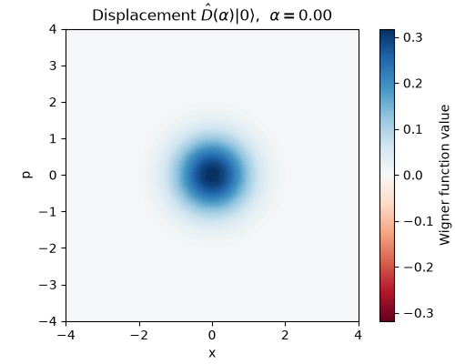
  - 
  - 
```

(sec:ops-rotation)=

### 3.2 Phase Rotation (Rotation About the Origin)

The phase-rotation gate $\hat{R}(\phi)$ rotates the state about the phase-space origin by the angle $\phi$. Its Heisenberg action is the rigid rotation

$$
\binom{\hat{x}}{\hat{p}} \;\longmapsto\;
\begin{pmatrix} \cos\phi & -\sin\phi \\ \sin\phi & \cos\phi \end{pmatrix}
\binom{\hat{x}}{\hat{p}},
$$

so $\mathbf{M}$ is an orthogonal rotation matrix and $\mathbf{d} = \mathbf{0}$. On a state centered at the origin, such as the vacuum, the rotation has no visible effect, since a rotationally symmetric blob is invariant. To see the rotation we therefore apply it to an off-center state. The figure below starts from the coherent state $\hat{D}(1.5)\ket{0}$ of the previous section and applies $\hat{R}(\pi/2)$: the blob swings a quarter turn around the origin, moving from the $x$ axis to the $p$ axis while keeping its shape and its distance from the origin.

```{list-table}
:widths: 33 34 33
:header-rows: 1
:align: center

* - Before: $\hat{D}(1.5)\ket{0}$
  - Evolution ($\phi: 0 \to \pi/2$)
  - After: $\hat{R}(\pi/2)\,\hat{D}(1.5)\ket{0}$
* - 
  - 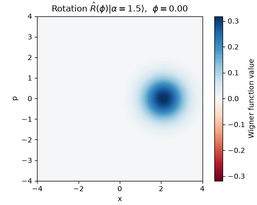
  - 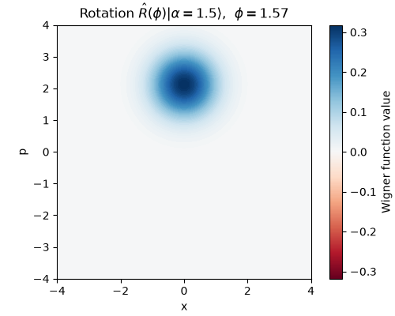
```

(sec:ops-squeezing)=

### 3.3 Squeezing (Stretch and Compress)

The squeezing gate $\hat{S}(r)$ is the first operation whose symplectic matrix is not merely a rigid motion: it stretches one quadrature while compressing the conjugate one, conserving phase-space area. Its Heisenberg action is diagonal,

$$
\binom{\hat{x}}{\hat{p}} \;\longmapsto\;
\begin{pmatrix} e^{-r} & 0 \\ 0 & e^{r} \end{pmatrix}
\binom{\hat{x}}{\hat{p}},
$$

with $\mathbf{d} = \mathbf{0}$, so the $x$ quadrature is scaled by $e^{-r}$ and the $p$ quadrature by $e^{r}$. Applied to the vacuum, the operation turns the circular blob into an ellipse: the uncertainty in $x$ drops below the vacuum level while the uncertainty in $p$ grows to compensate, producing the squeezed vacuum of {ref}`Introduction to Quantum States <sec:states>`. The figure below shows $\hat{S}(r)\ket{0}$ with $r = 0.8$.

```{list-table}
:widths: 33 34 33
:header-rows: 1
:align: center

* - Before: vacuum
  - Evolution ($r: 0 \to 0.8$)
  - After: $\hat{S}(0.8)\ket{0}$
* - 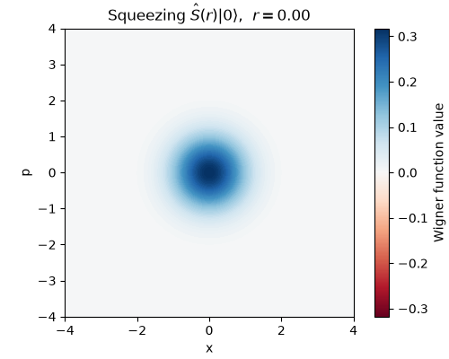
  - 
  - 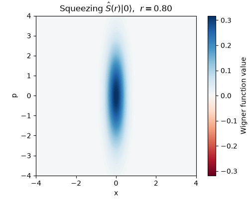
```

In all three cases the Wigner function stays non-negative and Gaussian in shape: translation moves it, rotation turns it, and squeezing reshapes it into an ellipse, but none of them can create the negative regions that signal non-classicality. That is the exclusive province of the non-Gaussian operations, to which we turn next.

---

(sec:ops-single-nongaussian)=

## 4. Single-Mode Non-Gaussian Operations

The Gaussian operations of {ref}`§3 <sec:ops-single-gaussian>` can only move, turn, and reshape a Gaussian blob; they can never make the Wigner function dip below zero. The non-Gaussian operations break exactly this limitation. Their generators are of order three or higher in $\hat{x}, \hat{p}$, so their action on phase space is no longer affine, and the resulting curvature can bend a positive Gaussian into a shape with genuinely negative regions. This section examines the two canonical examples, the Kerr gate and the cubic phase gate, and uses Wigner-function negativity as the visible signature of their non-Gaussian character.

(sec:ops-kerr)=

### 4.1 Kerr Gate

The Kerr gate $\hat{K}(\kappa) = \exp[i\kappa(\hat{a}^\dagger\hat{a})^2]$ is diagonal in the Fock basis, since $(\hat{a}^\dagger\hat{a})\ket{n} = n\ket{n}$ gives

$$
\hat{K}(\kappa)\ket{n} = e^{i\kappa n^2}\ket{n}.
$$

Each Fock component picks up a phase that grows *quadratically* with the Fock number $n$. This $n$-dependence is the source of the non-Gaussianity: a Gaussian state is a specific coherent superposition of Fock states, and rephasing each component by a different, nonlinearly spaced amount distorts that superposition into a non-Gaussian one.

Two consequences follow directly from the formula. First, the operation commutes with the number operator, so it leaves the Fock-number distribution untouched and only rearranges the phases. Second, on the vacuum and the Fock state $\ket{1}$ we have $n^2 = n$, so on a state with support only on $\ket{0}$ and $\ket{1}$ the Kerr gate acts exactly as the phase rotation $\hat{R}(\kappa)$ and shows no non-Gaussian effect; in particular the vacuum is left invariant. To see a visible effect we therefore apply the operation to a coherent state with appreciable mean Fock number. The figure below applies $\hat{K}(\kappa)$ with $\kappa = 0.25$ to the coherent state $\ket{\alpha = 1}$: the once-circular blob curls into a crescent, and a region of negative Wigner value (shown in red) appears, something no Gaussian operation could produce.

```{list-table}
:widths: 33 34 33
:header-rows: 1
:align: center

* - Before: $\ket{\alpha = 1}$
  - Evolution ($\kappa: 0 \to 0.25$)
  - After: $\hat{K}(0.25)\ket{\alpha = 1}$
* - 
  - 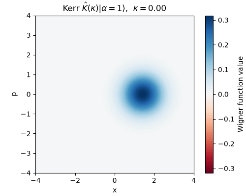
  - 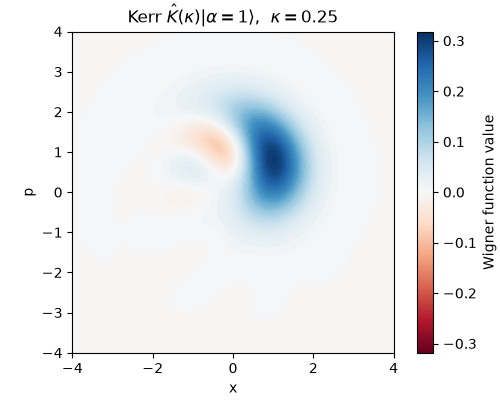
```

(sec:ops-cubic-phase)=

### 4.2 Cubic Phase Gate

The cubic phase gate $\widehat{\mathrm{CPG}}(\gamma) = \exp(i\gamma\hat{x}^3)$ is generated by the cubic term $\hat{x}^3$, the lowest-order generator that is non-Gaussian. It holds a special place in CV quantum computing: as noted in {ref}`§2.2 <sec:ops-adding-nongaussian>`, adjoining a cubic phase gate to the set of Gaussian operations already yields a universal gate set, which makes it the canonical "minimal" non-Gaussian resource.

Its effect is most transparent in the Heisenberg picture. Because the generator depends only on $\hat{x}$, the $x$ quadrature is left unchanged, while the $p$ quadrature is shifted by an amount proportional to $\hat{x}^2$:

$$
\hat{x} \;\longmapsto\; \hat{x}, \qquad
\hat{p} \;\longmapsto\; \hat{p} + 3\hbar\gamma\,\hat{x}^2 .
$$

This is a *shear* whose strength varies with $x$, a nonlinear deformation of phase space that no symplectic matrix can represent. Applied to a $p$-squeezed vacuum (squeezed so that the blob is narrow in $p$ and extended in $x$), the $x$-dependent momentum kick bends the state along a parabola. The figure below shows the result for $\gamma = 0.1$ acting on a squeezed vacuum with $r = 0.8$: the Wigner function curves into the characteristic cubic-phase shape and develops the oscillating fringes of alternating sign, including pronounced negative regions, that mark it as strongly non-classical.

```{list-table}
:widths: 33 34 33
:header-rows: 1
:align: center

* - Before: $p$-squeezed vacuum
  - Evolution ($\gamma: 0 \to 0.1$)
  - After: $\widehat{\mathrm{CPG}}(0.1)$ applied to the $p$-squeezed vacuum
* - 
  - 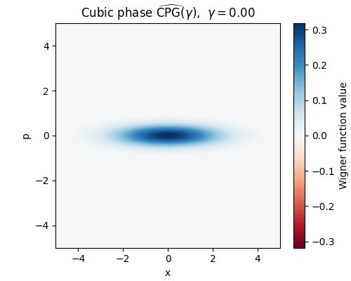
  - 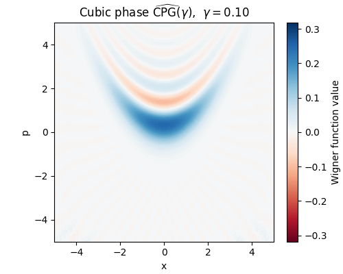
```

(sec:ops-nongaussianity)=

### 4.3 Negativity as a Signature of Non-Gaussianity

The two examples share a common diagnostic. The Gaussian operations of {ref}`§3 <sec:ops-single-gaussian>` keep the Wigner function non-negative everywhere, whereas both the Kerr gate and the cubic phase gate drive it negative. This is not a coincidence of the chosen parameters but a structural fact: by *Hudson's theorem*, a pure state has a non-negative Wigner function if and only if it is Gaussian. A pure state with any negative region is therefore necessarily non-Gaussian, and Wigner negativity becomes a clean, visual certificate that a genuinely non-Gaussian operation has taken place.

This negativity is also the resource that the universality argument of {ref}`§2 <sec:ops-universal>` ultimately relies on. It cannot be reproduced by any classical mixture of Gaussian states, and it is precisely what places the dynamics beyond the reach of the efficient classical simulation guaranteed for the Gaussian regime. The Kerr and cubic phase gates are the elementary operations that inject this resource into a circuit.

---

(sec:ops-two-mode)=

## 5. Two-Mode Operations

Every operation so far has acted on a single mode. Computation, however, also requires operations that *couple* modes, since correlations between modes are what make multi-mode quantum information more than the sum of its parts. The canonical two-mode Gaussian operation is the beam splitter, and the central new phenomenon it brings is *entanglement*. Because a two-mode state lives in the tensor product of two infinite-dimensional spaces, a single Wigner plot can no longer show it; we therefore confirm what the operation does through joint and reduced distributions instead.

(sec:ops-beam-splitter)=

### 5.1 Beam Splitter and Fock-Number Conservation

The beam splitter $\hat{B}(\theta, \phi)$ of {ref}`§1.2 <sec:ops-gate-definitions>` mixes two modes. Its generator $\theta(e^{i\phi}\hat{a}_1\hat{a}_2^\dagger - e^{-i\phi}\hat{a}_1^\dagger\hat{a}_2)$ moves excitations between the modes, and in the Heisenberg picture it acts as a rotation of the annihilation operators. For $\phi = 0$,

$$
\begin{aligned}
\hat{a}_1 &\;\longmapsto\; \cos\theta\,\hat{a}_1 - \sin\theta\,\hat{a}_2, \\
\hat{a}_2 &\;\longmapsto\; \sin\theta\,\hat{a}_1 + \cos\theta\,\hat{a}_2,
\end{aligned}
$$

where the *mixing angle* $\theta$ controls the splitting ratio; $\theta = \pi/4$ gives a balanced 50:50 beam splitter. A defining feature of this transformation is that it conserves the total Fock number: the total-number operator $\hat{n}_1 + \hat{n}_2$ commutes with the operation, so $\hat{B}$ only redistributes quanta between the two modes without creating or destroying any.

The conservation is vividly illustrated by sending one photon into each input port, that is, by acting on the two-mode Fock state $\ket{1,1}$ with a balanced beam splitter. The joint Fock-number distribution $P(n_1, n_2)$ before and after the operation is shown below.

```{list-table}
:widths: 100
:align: center

* - 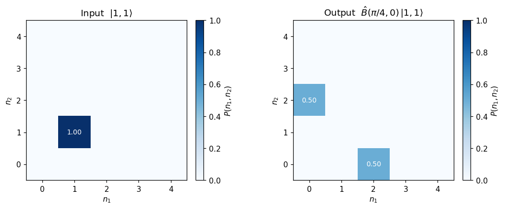
```

The input has its entire weight on $\ket{1,1}$. After the balanced beam splitter, the weight moves entirely to $\ket{0,2}$ and $\ket{2,0}$, each with probability $1/2$, while the outcome $\ket{1,1}$ disappears completely. In quantum optics, this is a two-photon interference effect known as *Hong–Ou–Mandel interference*, in which the two photons always leave together from the same port. The total Fock number remains exactly two in every superpositioned term of the output state (namely $\ket{0,2}$ and $\ket{2,0}$), confirming the conservation law: the operation redistributes the quanta but never changes their total.

Sweeping the mixing angle $\theta$ from $0$ to $\pi/2$ makes the interference continuous. The animation below tracks $P(n_1, n_2)$ across the sweep: starting from $\ket{1,1}$, the weight migrates to $\ket{0,2}$ and $\ket{2,0}$, reaching the balanced split at $\theta = \pi/4$, then recombines back to $\ket{1,1}$ at $\theta = \pi/2$, where the beam splitter has effectively swapped the two modes. At every angle the populated outcomes lie on the same anti-diagonal $n_1 + n_2 = 2$, a direct visual statement of Fock-number conservation.

```{list-table}
:widths: 100
:align: center

* - 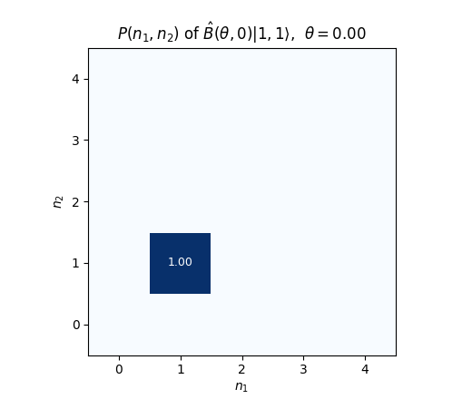
```

(sec:ops-entanglement)=

### 5.2 Generating Entanglement

Fock-number redistribution is closely tied to the second role of the beam splitter, generating *entanglement* between the two modes. A two-mode state is *entangled* when it cannot be written as a product $\ket{\psi}_1 \otimes \ket{\phi}_2$ of independent single-mode states. The standard diagnostic is the *reduced state* of one mode, obtained by tracing out the other: if the two modes are unentangled, each reduced state stays pure (purity $\mathrm{tr}(\hat{\rho}_1^2) = 1$), whereas entanglement makes each reduced state mixed (purity $< 1$), exactly the pure-versus-mixed distinction of {ref}`Introduction to Quantum States <sec:states>`.

Whether the beam splitter actually produces entanglement depends on the input. The figure below compares two cases, in each of which a single-mode state enters port 1 while the vacuum enters port 2, after a balanced beam splitter. Shown is the Fock-number distribution of the reduced state of mode 1, together with its purity.

```{list-table}
:widths: 100
:align: center

* - 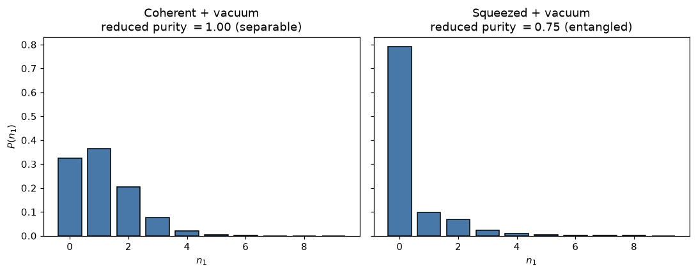
```

With a coherent state at the input, the reduced state stays pure (purity $1$): a beam splitter sends coherent light into a product of two coherent states and generates no entanglement, which is one precise sense in which coherent states behave classically. With a squeezed state at the input, the reduced state becomes mixed (purity $\approx 0.75$), the unmistakable signature that the output is entangled. The non-classicality carried by the squeezing is converted by the beam splitter into entanglement between the modes; this is the mechanism behind the EPR state of {ref}`Introduction to Quantum States <sec:states>`.

(sec:ops-confirming)=

### 5.3 Confirming the Change of State

The two figures above already demonstrate the two complementary ways of confirming what a multi-mode operation does, without ever drawing a joint Wigner function.

- The **joint Fock-number distribution** $P(n_1, n_2)$ of {ref}`§5.1 <sec:ops-beam-splitter>` reveals correlations between the modes directly. The collapse of $\ket{1,1}$ onto $\ket{0,2}$ and $\ket{2,0}$ is invisible in either mode alone and only appears in the joint statistics.
- The **reduced state** of a single mode, characterized by its Fock-number distribution and purity as in {ref}`§5.2 <sec:ops-entanglement>`, detects entanglement: a drop in purity certifies correlations with the partner mode that no local description can capture.

These distributions, joint and reduced Fock-number distributions and the homodyne distributions introduced in {ref}`Introduction to Measurement <sec:measurement>`, are reconstructed from repeated measurements, and together they let us verify the action of an operation even when its output is too complex to visualize as a single phase-space picture.

---

## Summary

In this introduction, we have learned the following:

1. **Operators as operations**: An operation is a unitary $\hat{U} = e^{-i\hat{G}}$ acting either on states (Schrödinger picture) or on observables (Heisenberg picture), and Gaussian operations act on the quadratures by a simple affine rule $\mathbf{r} \mapsto \mathbf{M}\mathbf{r} + \mathbf{d}$
2. **Universality**: Gaussian operations alone are classically simulable (the Bartlett–Sanders–Braunstein–Nemoto theorem) and cannot leave the Gaussian set; adding a single higher-order gate makes the set universal (the Lloyd–Braunstein theorem)
3. **Single-mode Gaussian operations**: Displacement translates, phase rotation rotates, and squeezing stretches and compresses the phase-space distribution, always keeping it Gaussian and non-negative
4. **Single-mode non-Gaussian operations**: The Kerr and cubic phase gates deform the state beyond Gaussian form and drive the Wigner function negative, with negativity serving (via Hudson's theorem) as a certificate of non-Gaussianity
5. **Two-mode operations**: The beam splitter conserves total Fock number and converts non-classicality into entanglement, whose effects are read off from joint and reduced distributions

Together with the state and measurement introductions, these operations complete the basic vocabulary of CV quantum computing: states to prepare, operations to transform, and measurements to read out.

---

## References

```{footbibliography}
```
