(sec:states)=

# Introduction to Quantum States

In conventional quantum computing (discrete-variable quantum computation), information is represented using *qubits* — superpositions of two basis states $\ket{0}$ and $\ket{1}$. In contrast, *continuous-variable (CV) quantum computing* encodes information in continuous-valued physical quantities.

In photonic quantum computing, the quantized electromagnetic field (photon field) serves as the information carrier. This system has the same mathematical structure as a *quantum harmonic oscillator* and can therefore be described within the harmonic oscillator framework. A key feature is that the photon field possesses a discrete orthonormal basis called the *Fock basis* (Fock number basis), while also having continuous-valued *quadratures* $x, p$. This duality underlies the richness of CV quantum computing.

|                            | Discrete Qubit                               | Continuous-Variable (CV)       |
| -------------------------- | -------------------------------------------- | ------------------------------ |
| Information capacity       | 2 discrete levels                            | Continuous (infinite) spectrum |
| Hilbert space dimension    | 2                                            | $\infty$                       |
| Physical degree of freedom | Spin, charge, etc.                           | Quadrature amplitudes ($x, p$) |
| Example devices            | Superconducting circuits, trapped ions, etc. | Optical circuits               |

---

## 1. Representations of Quantum States

There are multiple ways to describe quantum states, each suited to different purposes. Here we introduce four representations.

### 1.1 Wave Function

A complex-valued function $\psi(x)$ that represents a pure quantum state with respect to a continuous variable $x$. By the Born rule, $|\psi(x)|^2$ gives the probability density of obtaining a measurement outcome near $x$. Since the total probability must equal 1,

$$
\int_{-\infty}^{\infty} |\psi(x)|^2\, dx = 1
$$

must be satisfied. For photonic systems, $x$ corresponds to a quadrature (orthogonal component) of the electromagnetic field, and $|\psi(x)|^2$ describes the probability density distribution of homodyne measurement outcomes.

### 1.2 State Vector (Ket Vector)

An abstraction of the wave function for easier manipulation, representing a state as an element $\ket{\psi}$ of a Hilbert space. For example, expanding in the Fock basis gives

$$
\ket{\psi} = \sum_{n=0}^{\infty} c_n \ket{n}, \qquad \sum_{n=0}^{\infty} |c_n|^2 = 1
$$

However, both wave functions and state vectors can only describe *pure states* — states with no classical uncertainty.

### 1.3 Density Operator (Density Matrix)

The most general description of a state, including mixed states. It represents a statistical mixture of pure states $\ket{\psi_k}$, each occurring with probability $p_k$, encoded as a single operator:

$$
\hat{\rho} = \sum_k p_k \ket{\psi_k}\bra{\psi_k}, \qquad p_k \geq 0,\; \sum_k p_k = 1
$$

Here, $\bra{\psi_k}$ denotes the dual (bra) vector of $\ket{\psi_k}$.

The density operator has the following advantages:

- **Unique regardless of ensemble decomposition**: For the same mixed state, multiple decompositions $\{(p_k, \ket{\psi_k})\}$ exist, but $\hat{\rho}$ is uniquely determined
- **Can describe decoherence**: Loss of quantum coherence due to entanglement with the environment cannot be expressed using ket vectors or wave functions

For pure states, $\hat{\rho} = \ket{\psi}\bra{\psi}$ and $\mathrm{tr}(\hat{\rho}^2) = 1$, while for mixed states $\mathrm{tr}(\hat{\rho}^2) < 1$.

### 1.4 Wigner Function

A *quasiprobability distribution* on phase space $(x, p)$, defined from the density operator:

$$
W(x, p) = \frac{1}{\pi\hbar} \int_{-\infty}^{\infty} \bra{x + y}\hat{\rho}\ket{x - y}\, e^{-2ipy/\hbar}\, dy
$$

Intuitively, it evaluates the off-diagonal elements of the density matrix symmetric around position $x$, then Fourier-transforms over the displacement $y$ to obtain the momentum dependence. The Wigner function has the following properties:

- **Marginals reproduce probability distributions**: Integrating over $x$ yields the probability distribution for $p$, and integrating over $p$ yields the probability distribution for $x$
- **Can take negative values** (quasiprobability distribution), but all marginals (integrals over one variable) are non-negative probability distributions

The class of states whose Wigner function takes the form of a generalized Gaussian function (allowing a complex-valued mean) is called *Gaussian states*, fully characterized by a mean vector and covariance matrix alone (detailed in {ref}`§3 <sec:states-gaussian>`).

---

## 2. Fock Basis (Fock Number Basis)

We introduce the Fock basis, which serves as a complete orthonormal basis for CV systems. Starting from the Hamiltonian of the photon field, we define the creation and annihilation operators and obtain Fock states as the energy eigenstates of the Hamiltonian.

### 2.1 Hamiltonian and Creation/Annihilation Operators

When the free electromagnetic field in vacuum is quantized, it decomposes into independent *modes* — each mode is a single oscillator degree of freedom characterized by a specific frequency and polarization, and is described as a quantum harmonic oscillator. The single-mode Hamiltonian takes the form:

$$
\hat{H} = \frac{\omega}{2}\left(\hat{x}^2 + \hat{p}^2\right)
$$

Here $\hat{x}, \hat{p}$ are quadrature operators satisfying the canonical commutation relation $[\hat{x}, \hat{p}] = i\hbar$. They share the same mathematical structure as position and momentum in the mechanical harmonic oscillator {footcite}`Gerry2005`, but in the photonic case they correspond to orthogonal components of the electromagnetic field and are conventionally referred to simply as $x, p$.

Noting that this Hamiltonian has the form $\hat{x}^2 + \hat{p}^2$, we define the *annihilation operator* $\hat{a}$ and *creation operator* $\hat{a}^\dagger$ so that $\hat{H}$ can be expressed in terms of $\hat{a}^\dagger\hat{a}$:

$$
\hat{a} = \frac{1}{\sqrt{2\hbar}}(\hat{x} + i\hat{p}), \qquad
\hat{a}^\dagger = \frac{1}{\sqrt{2\hbar}}(\hat{x} - i\hat{p})
$$

These satisfy the commutation relation $[\hat{a}, \hat{a}^\dagger] = 1$, and the Hamiltonian becomes

$$
\hat{H} = \hbar\omega\left(\hat{a}^\dagger\hat{a} + \frac{1}{2}\right) = \hbar\omega\left(\hat{N} + \frac{1}{2}\right)
$$

where $\hat{N} = \hat{a}^\dagger\hat{a}$ is the *number operator*.

### 2.2 Fock States and Energy Levels

The eigenstates of the number operator $\hat{N}$ are called *Fock states* (number states) $\ket{n}$:

$$
\hat{N}\ket{n} = n\ket{n}, \qquad n = 0, 1, 2, \ldots
$$

Since $\hat{H} = \hbar\omega\!\left(\hat{N} + \frac{1}{2}\right)$, Fock states are also energy eigenstates, with eigenvalues:

$$
E_n = \hbar\omega\left(n + \frac{1}{2}\right)
$$

The discrete energy levels directly reflect the discrete nature of the Fock number. Fock states are mutually orthogonal,

$$
\braket{m|n} = \delta_{mn}
$$

and therefore form an orthonormal basis for the CV system. Any quantum state can be expanded in this basis.

#### Fock-number cutoff in numerical simulation

The Fock basis $\{\ket{0}, \ket{1}, \ket{2}, \dots\}$ consists of countably infinite elements, spanning an infinite-dimensional Hilbert space. Bosonic states such as coherent states and squeezed states require an infinite superposition $\sum_{n=0}^{\infty} c_n \ket{n}$, and therefore cannot be stored exactly on a computer. In practice, one must truncate the Hilbert space at a finite Fock number $n_{\max}$, retaining only the first $n_{\max}+1$ Fock states. This *Fock-number cutoff* introduces an approximation: states with significant population beyond $n_{\max}$ are not faithfully captured, leading to artifacts in quantities such as the Wigner function.

The figures below illustrate the effect of the Fock-number cutoff on the Wigner function of a coherent state. Because coherent states are Gaussian, they can be represented exactly in the bosonic representation, providing a ground-truth reference; comparing against it highlights the truncation artifacts in the Fock-basis columns clearly. Each column is labeled by $D$, the number of retained Fock states ($D = n_{\max} + 1$, so $n_{\max} = D - 1$).

```{list-table}
:widths: 25 25 25 25
:header-rows: 1
:align: center

* - $D = 3$
  - $D = 5$
  - $D = 10$
  - Bosonic (exact)
* - 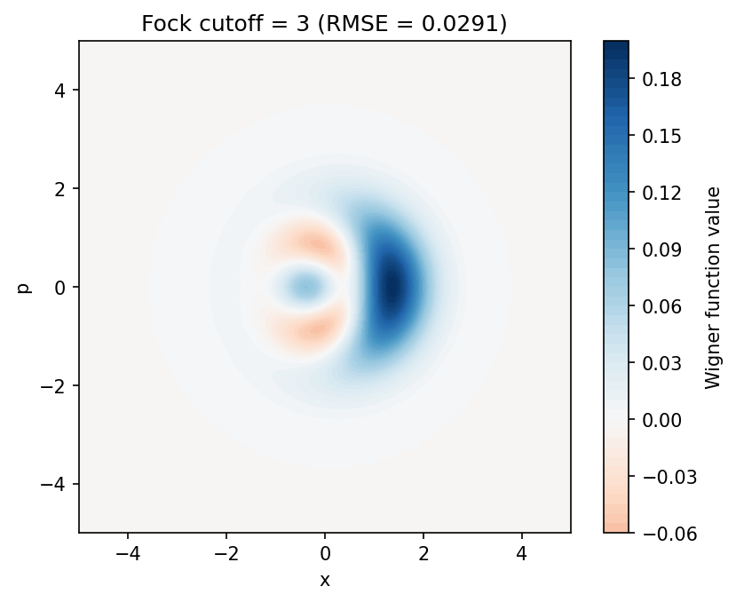
  - 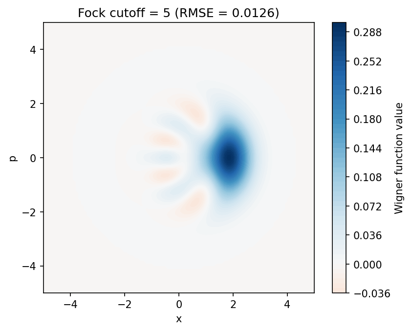
  - 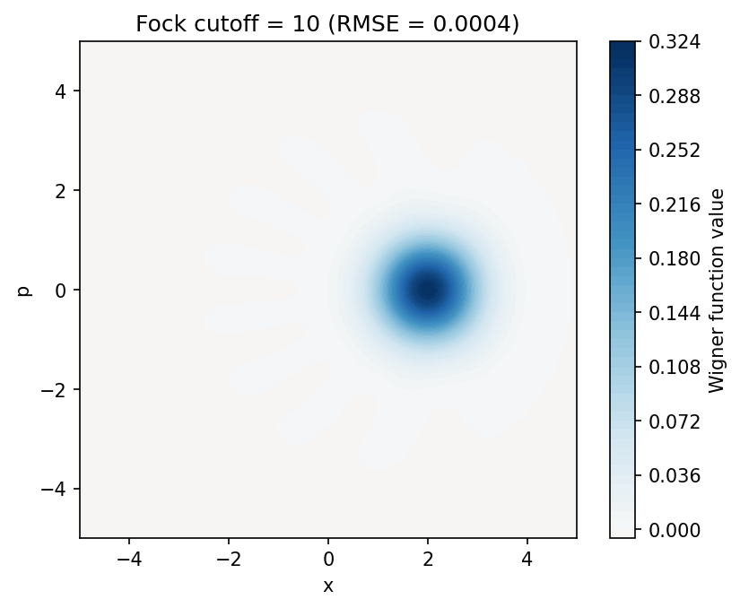
  - 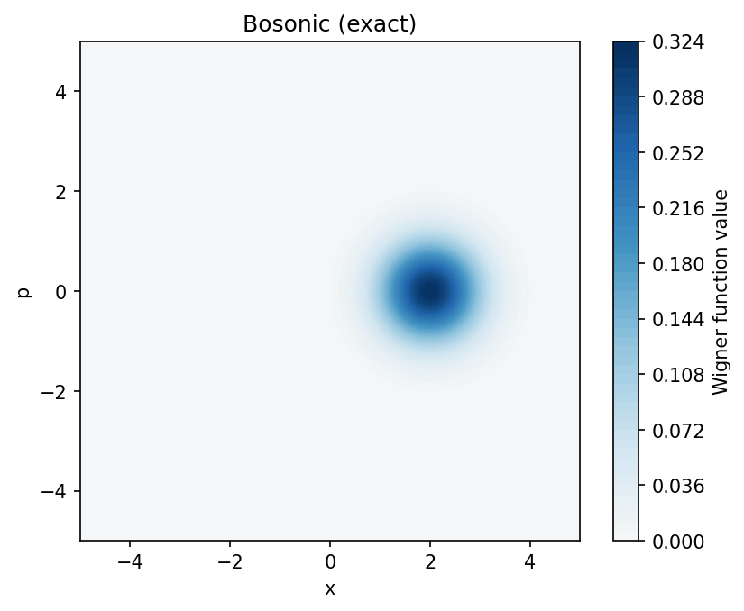
```

The cutoff dimension is set per mode: a state carries one cutoff per mode, reported by
{py:attr}`~claveles.circuit.state.QuantumState.cutoff_dims`, and different modes may use different values — the
simulator keeps them separate (a joint state keeps each mode's own cutoff, and
{py:meth}`~claveles.circuit.state.QuantumState.extract_mode` gives a mode's reduced density matrix at that
cutoff) rather than unifying to a common size. Because operations such as a beam splitter can scatter
population from a high-cutoff mode into a low-cutoff one, where components at or above the target cutoff
are truncated, size each mode's cutoff for the Fock numbers it holds *after* such interactions — not just
its initial state.

---

(sec:states-gaussian)=

## 3. Description of Gaussian States

Gaussian states are the class of states whose Wigner function takes the form of a generalized Gaussian function (allowing a complex-valued mean). For a single mode, the state is completely described by two parameters:

- **Mean vector** $\boldsymbol{\mu} = (\langle \hat{x} \rangle, \langle \hat{p} \rangle)^T$
- **Covariance matrix** $\boldsymbol{\Sigma}$: with components $\Sigma_{ij} = \frac{1}{2}\langle \{\Delta\hat{r}_i, \Delta\hat{r}_j\}\rangle$ ($\hat{r} = (\hat{x}, \hat{p})^T$)

The Wigner function is

$$
W(x, p) = \frac{1}{2\pi\sqrt{\det\boldsymbol{\Sigma}}} \exp\left(-\frac{1}{2}(\mathbf{r} - \boldsymbol{\mu})^T \boldsymbol{\Sigma}^{-1} (\mathbf{r} - \boldsymbol{\mu})\right)
$$

In the Claveles simulator, general bosonic states are represented as weighted sums of Gaussian components:

$$
W_{\rm total}(x, p) = \sum_k c_k\, W_k(x, p;\, \boldsymbol{\mu}_k, \boldsymbol{\Sigma}_k)
$$

Here the weights $c_k$ can take negative values, but all marginals must be non-negative probability distributions.

---

## 4. Various Quantum States

Here we introduce states that frequently appear in CV quantum computing and build intuition through Wigner function visualizations.

(sec:states-vacuum)=

### 4.1 Vacuum State

The eigenstate of the annihilation operator $\hat{a}$ with eigenvalue $0$, representing the ground state from which no more energy can be removed:

$$
\hat{a}\ket{0} = 0
$$

The Wigner function is an isotropic Gaussian function centered at the origin, with covariance matrix

$$
\boldsymbol{\Sigma}_{\rm vac} = \frac{\hbar}{2}\mathbf{I}
$$

This is a minimum uncertainty state with equal uncertainty $\Delta x = \Delta p = \sqrt{\hbar/2}$ in both the $x$ and $p$ directions.

```{image} _images/states/vacuum.png
:alt: Wigner function of the vacuum state
:width: 50%
```

(sec:states-coherent)=

### 4.2 Coherent State

A state obtained by applying the *displacement operator* $\hat{D}(\alpha) = \exp(\alpha\hat{a}^\dagger - \alpha^*\hat{a})$ to the vacuum state:

$$
\ket{\alpha} = \hat{D}(\alpha)\ket{0}
$$

The Wigner function has the same shape as the vacuum state (isotropic Gaussian), but the center is displaced to $(\sqrt{2\hbar}\,\mathrm{Re}\,\alpha,\, \sqrt{2\hbar}\,\mathrm{Im}\,\alpha)$. It corresponds to the quantum-mechanical description of laser light and is the quantum state closest to classical light. The figure below shows the case $\alpha = 2 + i$.

```{image} _images/states/coherent.png
:alt: Wigner function of a coherent state
:width: 50%
```

(sec:states-squeezed)=

### 4.3 Squeezed State

A state obtained by applying the squeezing operator $\hat{S}(r) = \exp\!\left[\frac{r}{2}(\hat{a}^2 - \hat{a}^{\dagger 2})\right]$ to the vacuum state. It trades off uncertainty between the $x$ and $p$ directions:

$$
\Delta x = e^{-r}\sqrt{\frac{\hbar}{2}}, \qquad \Delta p = e^{r}\sqrt{\frac{\hbar}{2}}
$$

The covariance matrix is

$$
\boldsymbol{\Sigma}_{\rm sq} = \frac{\hbar}{2}\begin{pmatrix} e^{-2r} & 0 \\ 0 & e^{2r} \end{pmatrix}
$$

This is a minimum uncertainty state satisfying the uncertainty relation $\Delta x \cdot \Delta p = \hbar/2$ with equality.

Squeezed states are a fundamental resource for CV quantum computing, used as physical approximations to $x$-eigenstates or $p$-eigenstates. The larger the squeezing parameter $r$, the smaller the uncertainty in one quadrature becomes, approaching the ideal $x$ (or $p$) eigenstate.

|                    $x$-squeezed                    |                    $p$-squeezed                    |
| :------------------------------------------------: | :------------------------------------------------: |
| 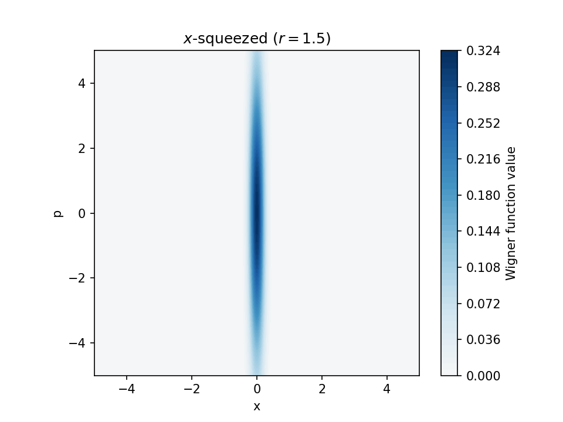 | 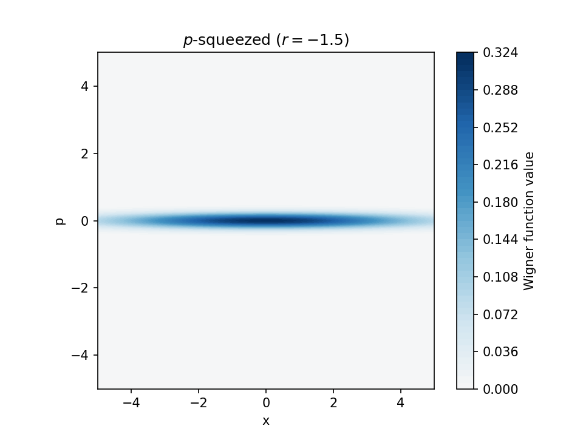 |

(sec:squeezing-level-and-squeezing-angle)=

#### Squeezing level and squeezing angle

The state above is squeezed along $x$. Rotating it through an angle $\phi$ in phase space gives the squeezed state of **squeezing angle** $\phi$, whose covariance matrix is

$$
\boldsymbol{\Sigma}_{\rm sq}(r, \phi) = R(\phi)\,\boldsymbol{\Sigma}_{\rm sq}\,R(\phi)^T, \qquad
R(\phi) = \begin{pmatrix} \cos\phi & -\sin\phi \\ \sin\phi & \cos\phi \end{pmatrix}
$$

The squeezed quadrature is then $\hat{x}\cos\phi + \hat{p}\sin\phi$, so $\phi = 0$ is the $x$-squeezed state and $\phi = \pi/2$ the $p$-squeezed one, as in the two figures. Rotating by $\pi$ gives back the same state, so the angle only matters modulo $\pi$. This $\phi$ is the `phi` of {py:meth}`QuantumState.squeezed <claveles.circuit.state.QuantumState.squeezed>` and {py:meth}`QuantumState.hardware_squeezed <claveles.circuit.state.QuantumState.hardware_squeezed>`.

A squeezing angle belongs to a state; it is not the angle of a homodyne measurement, even where both are written $\phi$. {py:class}`std.MeasureHomodyne(phi) <claveles.circuit.ops.std.MeasureHomodyne>` measures $\hat{x}\cos\phi + \hat{p}\sin\phi$, which on a state of squeezing angle $\phi$ happens to be the squeezed quadrature. The intrinsic and graph-representation measurements instead take an angle $\theta$ that measures $\hat{x}\sin\theta + \hat{p}\cos\theta$, and a {ref}`graph.ops.Initialization <sec:gate-graph-repr-initialization>` at $\theta$ leaves a mode of squeezing angle $\theta + \pi/2$.

The **squeezing level** gives the amount of squeezing in decibels, relative to the vacuum variance $\hbar/2$. A level of $s$ dB means that the squeezed quadrature has variance $10^{-s/10} \cdot \hbar/2$ and the anti-squeezed quadrature, orthogonal to it, $10^{s/10} \cdot \hbar/2$. For the state above, $s = 10\log_{10} e^{2r} \approx 8.69\,r$. Where an **anti-squeezing level** $a$ is given as well, the anti-squeezed variance is $10^{a/10} \cdot \hbar/2$ instead. When $a$ is larger than $s$, the product of the two variances exceeds $(\hbar/2)^2$, and the state is not pure.

(sec:states-epr)=

### 4.4 EPR State (Two-Mode Squeezed Vacuum)

A state with strong quantum correlations between two modes, analogous to a Bell state in the CV regime. It is generated by applying the two-mode squeezing operator

$$
\widehat{\mathrm{TS}}(r) = \exp\!\left[r(\hat{a}_1^\dagger\hat{a}_2^\dagger - \hat{a}_1\hat{a}_2)\right]
$$

to the two-mode vacuum state. In the limit $r \to \infty$, it approaches the ideal EPR state ($x_1 - x_2 \to 0$, $p_1 + p_2 \to 0$). It is used as the entanglement resource for quantum teleportation, and it is the resource the machine itself is built from: the machine generates such entangled pairs from squeezed light and delays one mode of each pair to form the cluster state it computes on.

No figure is shown here, because the state spans two modes: its Wigner function is a distribution over four variables and has no single phase-space picture. What can be drawn instead is the *reduced* state of one mode, which for an EPR state is a thermal state — the purity dropping below 1 is exactly the signature of the entanglement, as {ref}`§5.2 of the operations introduction <sec:ops-entanglement>` shows for the beam splitter that produces it. In the SDK, {py:meth}`QuantumState.epr <claveles.circuit.state.QuantumState.epr>` builds the state and {py:meth}`extract_mode <claveles.circuit.state.QuantumState.extract_mode>` takes that reduced state; see {ref}`Working with Quantum States <sec:quantum-states-in-the-sdk>`.

(sec:states-cat)=

### 4.5 Cat State

A non-classical state defined as a quantum superposition of coherent states:

$$
\ket{\mathrm{cat}_\pm} \propto \ket{\alpha} \pm \ket{-\alpha}
$$

$\ket{\mathrm{cat}_+}$ (even cat state) contains only even Fock numbers, while $\ket{\mathrm{cat}_-}$ (odd cat state) contains only odd Fock numbers. The Wigner function exhibits quantum interference fringes between the two Gaussian peaks, serving as evidence of non-classicality.

```{image} _images/states/cat.png
:alt: Wigner function of a cat state
:width: 50%
```

(sec:states-gkp)=

### 4.6 GKP State

The Gottesman–Kitaev–Preskill (GKP) code {footcite}`PhysRevA.64.012310` is a bosonic code that encodes a qubit in a CV system. The ideal GKP states have a lattice structure with $x$-eigenstates arranged at equal intervals:

$$
\ket{0}_{\rm gkp} \propto \sum_{n \in \mathbb{Z}} \ket{x = 2n\sqrt{\pi\hbar}}, \qquad
\ket{1}_{\rm gkp} \propto \sum_{n \in \mathbb{Z}} \ket{x = (2n+1)\sqrt{\pi\hbar}}
$$

$\ket{0}_{\rm gkp}$ is distributed at even-numbered bins ($2n\sqrt{\pi\hbar}$), while $\ket{1}_{\rm gkp}$ is distributed at odd-numbered bins ($(2n+1)\sqrt{\pi\hbar}$).

The error tolerance of the GKP code arises from the fact that even if each peak undergoes small shifts, the even-odd distinction remains possible. In finite-energy approximate GKP states, each delta function is replaced by a Gaussian, with a parameter $\epsilon > 0$ controlling the approximation quality.

|           $\ket{0}_{\rm gkp}$            |           $\ket{1}_{\rm gkp}$            |
| :--------------------------------------: | :--------------------------------------: |
| 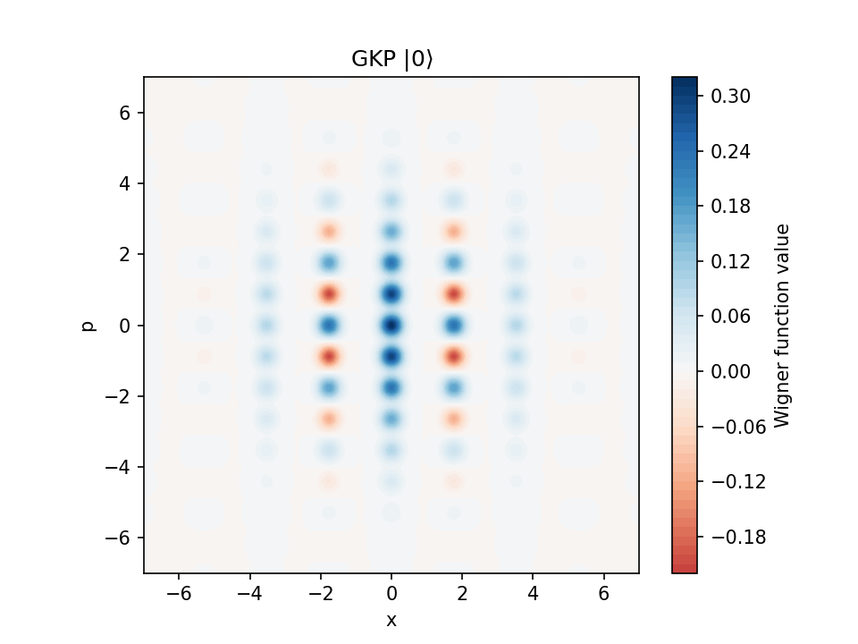 | 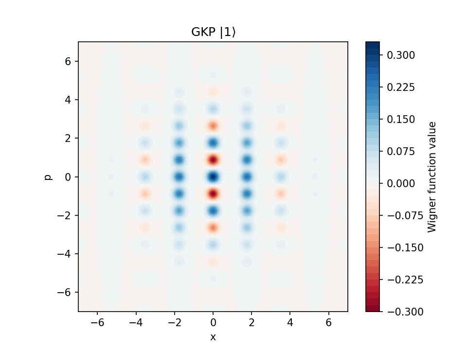 |

(sec:states-thermal)=

### 4.7 Thermal Equilibrium State

In contrast to pure states ($\mathrm{tr}(\hat{\rho}^2) = 1$), the thermal equilibrium state is a physically important example of a *mixed state* ($\mathrm{tr}(\hat{\rho}^2) < 1$) {footcite}`Gerry2005`.

The single-mode thermal equilibrium state at temperature $T$ is described as a Gibbs state:

$$
\hat{\rho}_{\rm th} = \frac{e^{-\beta\hat{H}}}{Z}, \qquad Z = \mathrm{tr}(e^{-\beta\hat{H}}), \qquad \beta = \frac{1}{k_B T}
$$

Expanding in the Fock basis gives

$$
\hat{\rho}_{\rm th} = \sum_{n=0}^{\infty} \frac{\bar{n}^n}{(\bar{n}+1)^{n+1}} \ket{n}\bra{n}
$$

where $\bar{n} = 1/(e^{\beta\hbar\omega} - 1)$ is the mean photon number (Bose-Einstein distribution).

#### Wigner Function

The thermal equilibrium state is a Gaussian state. Substituting $\boldsymbol{\mu} = 0$, $\boldsymbol{\Sigma} = \frac{\hbar}{2}(2\bar{n}+1)\mathbf{I}$ into the Wigner function from {ref}`§3 <sec:states-gaussian>` yields an isotropic Gaussian function centered at the origin:

$$
W_{\rm th}(x, p) = \frac{1}{\pi\hbar(2\bar{n}+1)} \exp\left(-\frac{x^2 + p^2}{\hbar(2\bar{n}+1)}\right)
$$

The variance for each quadrature is $\sigma^2 = \hbar(2\bar{n}+1)/2$. At $\bar{n} = 0$ (zero temperature), this coincides with the vacuum state ($\sigma^2 = \hbar/2$). As the temperature increases ($\bar{n}$ grows larger), the variance increases.

```{list-table}
:widths: 25 25 25 25
:header-rows: 1
:align: center

* - $\bar{n} = 0$ (vacuum)
  - $\bar{n} = 0.5$
  - $\bar{n} = 2$
  - $\bar{n} = 5$
* - 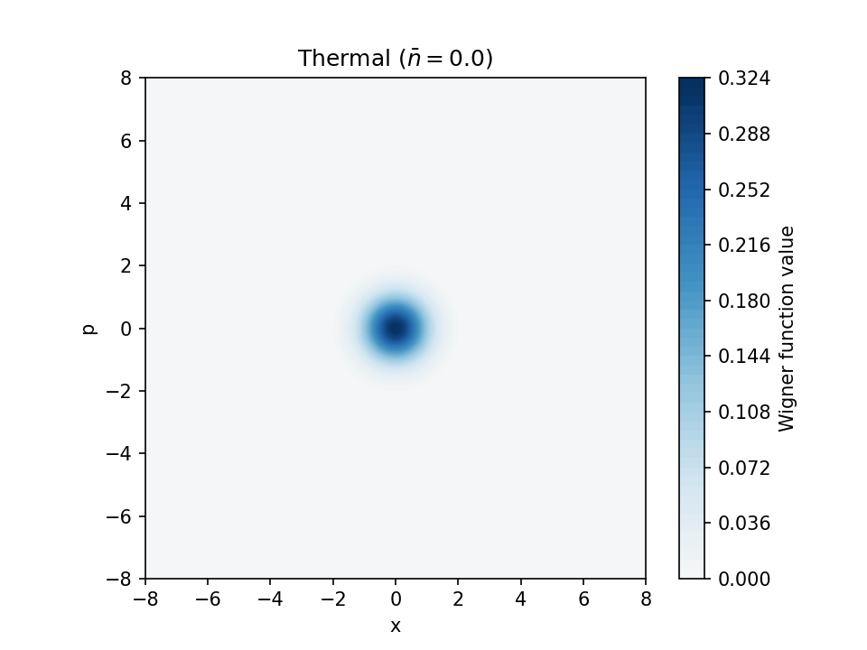
  - 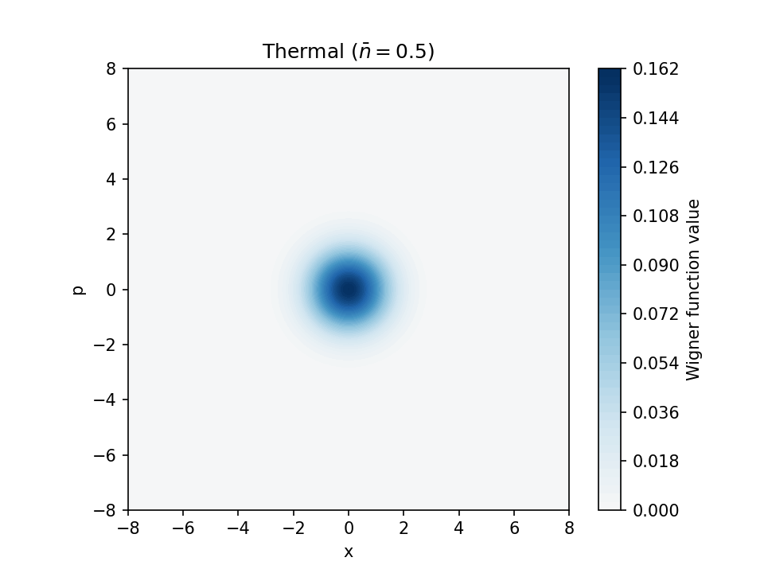
  - 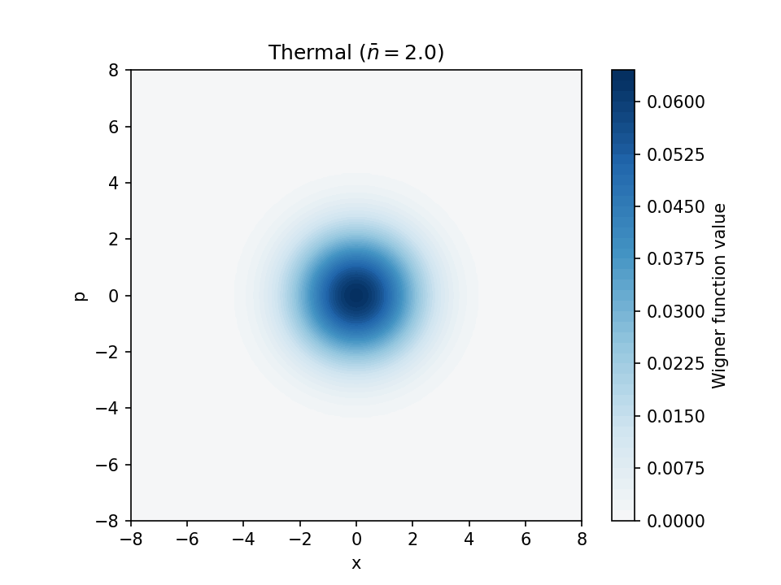
  - 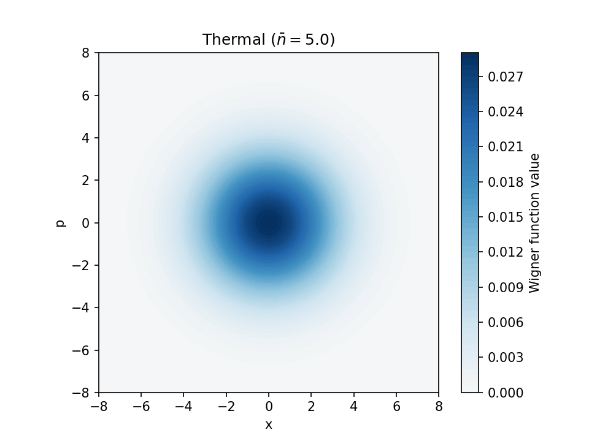
```

#### Confirming the Mixed-State Nature

The mixed-state nature of the thermal equilibrium state can be confirmed from the *purity* $\mathrm{tr}(\hat{\rho}^2)$:

$$
\mathrm{tr}(\hat{\rho}_{\rm th}^2) = \sum_{n=0}^{\infty} \left(\frac{\bar{n}}{\bar{n}+1}\right)^{2n} \frac{1}{(\bar{n}+1)^2} = \frac{1}{2\bar{n}+1}
$$

When $\bar{n} > 0$, $\mathrm{tr}(\hat{\rho}^2) < 1$, confirming that it is a mixed state. This is also visually apparent: the variance being larger than that of the vacuum state reflects that "the state is a statistical mixture of multiple energy eigenstates."

From the isotropic spread (variance $\sigma^2$) of the Gaussian, we can read off $\bar{n}$ as $\bar{n} = \sigma^2/\hbar - 1/2$. When the variance exceeds $\hbar/2$ (the vacuum state value), $\bar{n} > 0$, indicating a finite-temperature mixed state.

For bosons, since infinitely many energy levels (Fock states $\ket{n}$) exist, at finite temperature multiple levels are necessarily occupied, resulting in a mixed state. Only in the limit of inverse temperature $\beta \to \infty$ (zero temperature) does the occupation probability of the ground state $\ket{0}$ approach 1, converging to a pure state:

$$
\mathrm{tr}(\hat{\rho}_{\rm th}^2) = \frac{1 - e^{-\beta\hbar\omega}}{1 + e^{-\beta\hbar\omega}} \to 1 \quad (\beta \to \infty)
$$

The {py:class}`std.ThermalLossChannel <claveles.circuit.ops.std.ThermalLossChannel>` uses this state as its environment: at transmittance $T = 0$ it maps any input to the thermal equilibrium state with covariance $\frac{\hbar}{2}(2\bar{n}+1)\mathbf{I}$ (see {ref}`Gates & Operations <sec:gates>`).

(sec:states-fock)=

### 4.8 Fock State (Fock Number State)

The Fock state $\ket{n}$ is the eigenstate of the number operator $\hat{N}$ with Fock number $n$. Its Wigner function $W_n(x, p)$ is given by

$$
W_n(x, p) = \frac{(-1)^n}{\pi\hbar} e^{-(x^2 + p^2)/\hbar} L_n\!\left(\frac{2(x^2 + p^2)}{\hbar}\right)
$$

where $L_n$ is the $n$-th Laguerre polynomial. The function is rotationally symmetric and takes negative values for $n \geq 1$, a signature of non-classicality. The vacuum state $\ket{0}$ reduces to the isotropic Gaussian of {ref}`§4.1 <sec:states-vacuum>`, while higher Fock states exhibit concentric rings of alternating sign. The Wigner functions for $n = 0, 1, 2, 3$ are shown below.

```{list-table}
:widths: 25 25 25 25
:header-rows: 1
:align: center

* - $\ket{0}$
  - $\ket{1}$
  - $\ket{2}$
  - $\ket{3}$
* - 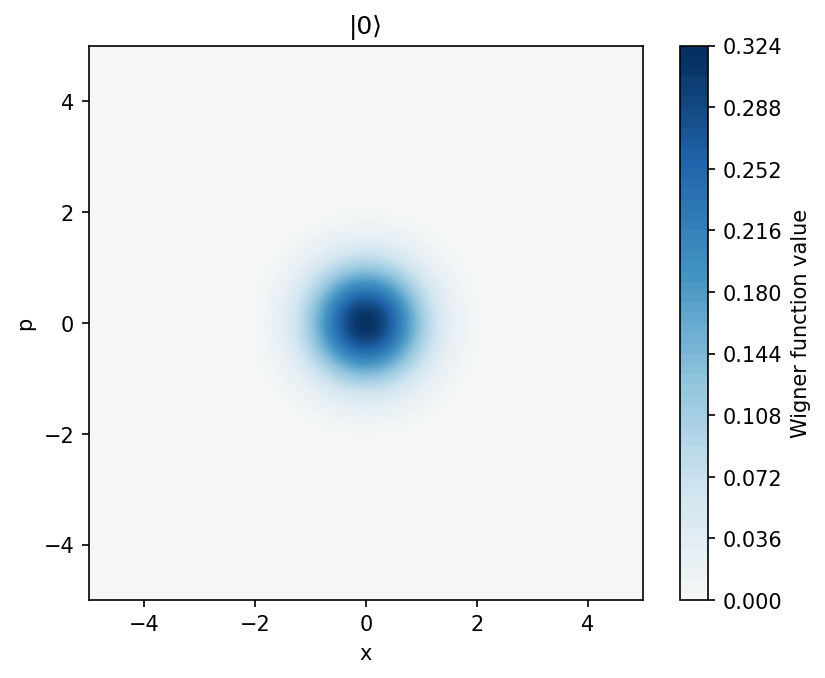
  - 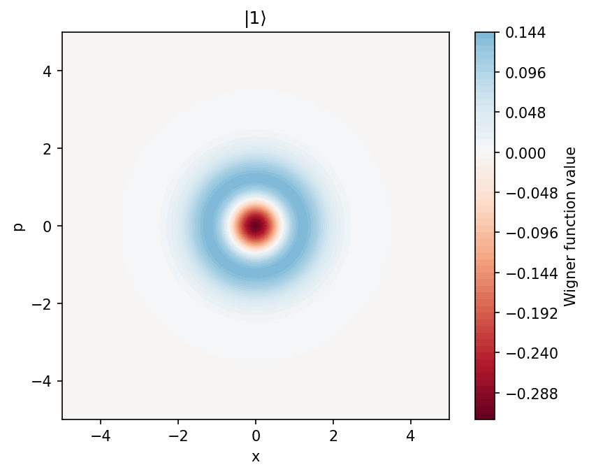
  - 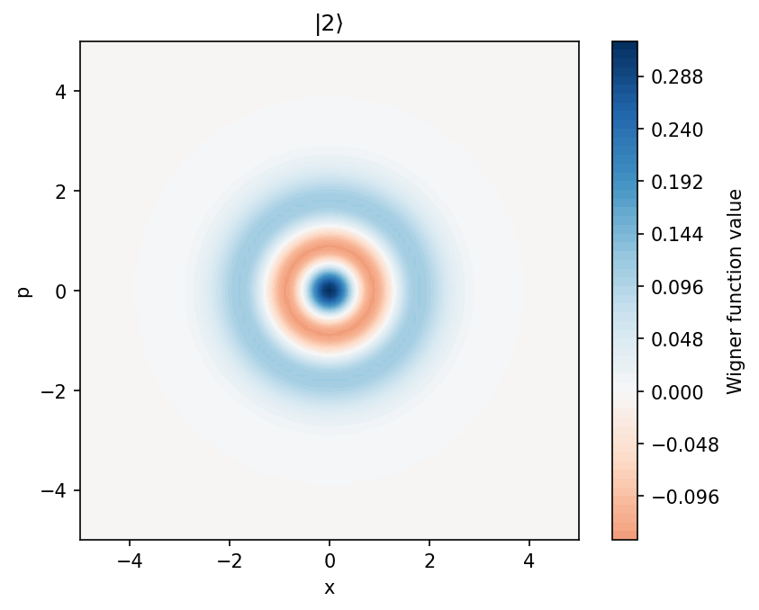
  - 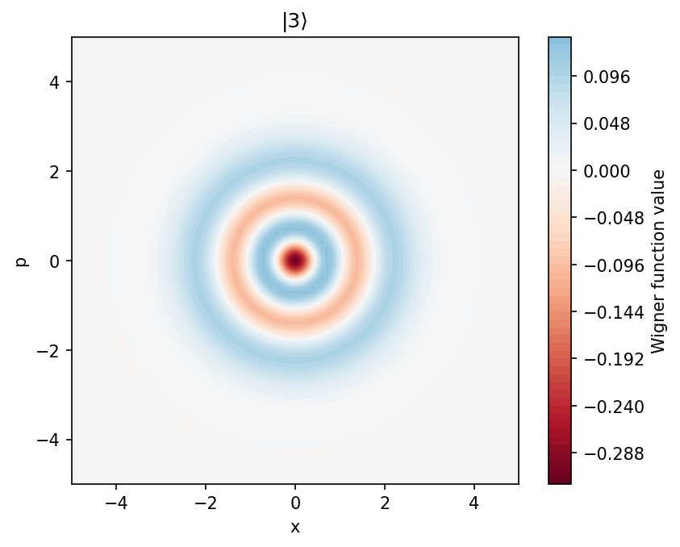
```

---

## Summary

In this tutorial, we have learned the following:

1. **Motivation for CV quantum computing**: In contrast to discrete qubits, CV systems handle information in an infinite-dimensional Hilbert space. Photonic quantum computing is formulated within the quantum harmonic oscillator framework
2. **Fock basis**: Creation/annihilation operators and the number operator are derived from the Hamiltonian of the quantized electromagnetic field, and the eigenstates of the number operator — the Fock states — form the orthonormal basis of the CV system
3. **State representations**: There are four description methods — ket vectors, wave functions, density operators, and Wigner functions — with the density operator being the most general representation that encompasses mixed states
4. **Gaussian states**: Completely described by a mean vector and covariance matrix, with a Gaussian Wigner function. In Claveles, general states are represented as weighted sums of Gaussian components
5. **Specific states**: The physical meaning and mathematical structure of vacuum, coherent, squeezed, EPR, cat, GKP, thermal equilibrium, and Fock number states

Where to go next:

* {ref}`Introduction to Measurement <sec:measurement>` — how a state is read out, and what the two measurement schemes can and cannot tell you about it.
* {ref}`Introduction to Gate Operations <sec:ops>` — how a state is transformed, and why one non-Gaussian operation is enough for universality.
* {ref}`States <sec:state-primitives>` — every state on this page as the factory that builds it.
* {ref}`Working with Quantum States <sec:quantum-states-in-the-sdk>` — every state on this page as an object you can place on a circuit, plot and read back from a simulation.

---

## References

```{footbibliography}
```

